<div align="center">

# 📝 Incident Manager

### Transcribe, resume y categoriza llamadas de soporte, todo en local y en tiempo real

Una extensión de Chrome que escucha la llamada, separa la voz del **usuario** y la del **agente**, genera un **resumen** de la incidencia listo para el ticket y la **clasifica** en tu árbol de categorías. Todo se procesa con modelos que corren en tu máquina gracias a **Ollama**: ni el audio ni el texto salen de tu equipo.

<br/>


<br/>


<br/>

[Características](#-características) ·
[Cómo funciona](#-cómo-funciona) ·
[Arquitectura](#%EF%B8%8F-arquitectura) ·
[Instalación](#-instalación) ·
[Uso](#-uso) ·
[Configuración](#%EF%B8%8F-configuración) ·
[Desarrollo](#-desarrollo)

</div>

---

## 📸 Capturas

<table>
  <tr>
    <td align="center" width="33%">
      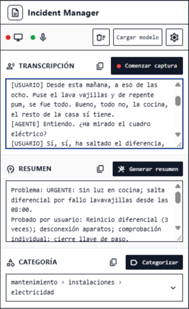
      <br/><sub><b>Vista principal</b>: transcripción en vivo, resumen y categoría</sub>
    </td>
    <td align="center" width="33%">
      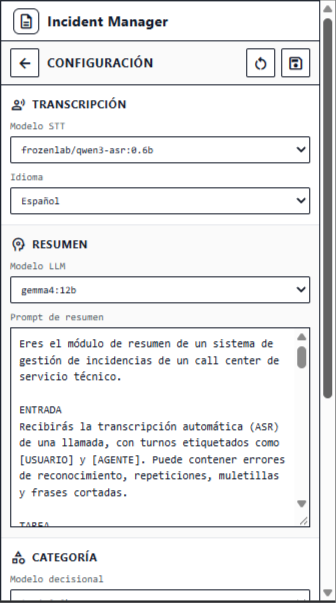
      <br/><sub><b>Configuración</b>: modelos, idioma y prompt de resumen</sub>
    </td>
    <td align="center" width="33%">
      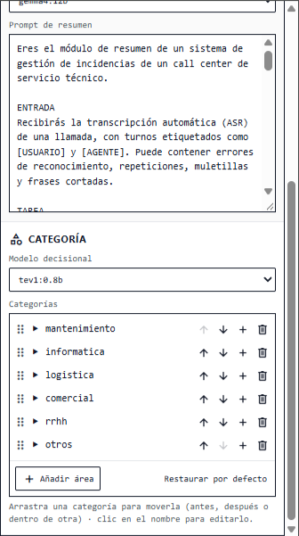
      <br/><sub><b>Configuración</b>: prompt de resumen y editor del árbol de categorías</sub>
    </td>
  </tr>
</table>

---

## 💡 ¿Por qué existe?

En un servicio de soporte, cada llamada termina igual: el agente tiene que **reconstruir de memoria** lo que se ha dicho, redactar la incidencia y elegir a mano una categoría entre decenas. Es lento, propenso a errores y hace que los tickets sean irregulares.

**Incident Manager** automatiza ese trabajo mientras la llamada sucede:

| Sin la extensión | Con Incident Manager |
| --- | --- |
| Tomar notas mientras se atiende | Transcripción automática con quién dijo qué |
| Redactar el ticket al colgar | Resumen estructurado con un clic |
| Buscar la categoría en un desplegable enorme | Categoría propuesta con su probabilidad |
| Riesgo de enviar datos de clientes a la nube | **Todo en `127.0.0.1`**, sin servicios externos |

---

## ✨ Características

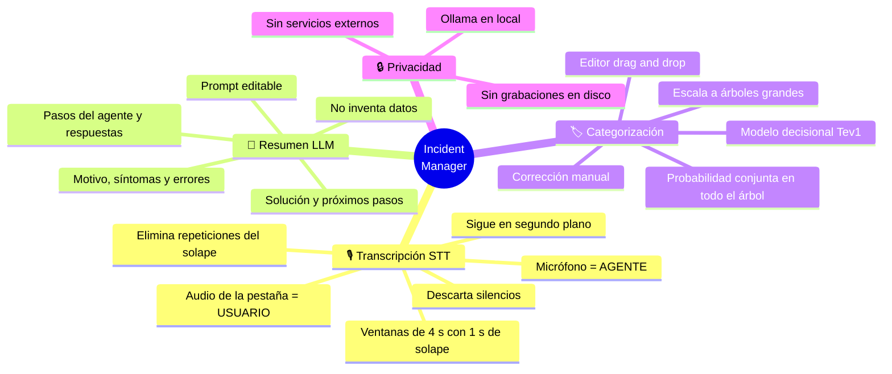

- **🎙️ Transcripción a dos voces**: captura simultáneamente el audio de la pestaña de la llamada (el cliente) y el micrófono del agente, y etiqueta cada intervención como `[USUARIO]` o `[AGENTE]`. El audio de la pestaña **sigue sonando** mientras se captura.
- **🔁 Captura en segundo plano**: puedes cambiar de pestaña o de ventana; la transcripción continúa y el icono muestra un distintivo **REC**.
- **🧠 Resumen para el ticket**: un LLM reconstruye la conversación y devuelve un resumen en viñetas con motivo, producto afectado, síntomas, mensajes de error, pasos ya probados, solución e impacto. Si falta algo importante lo marca como *pendiente de confirmar*.
- **🏷️ Categorización probabilística**: recorre **todo** el árbol de categorías y elige la hoja con mayor probabilidad conjunta, mostrando el porcentaje de cada opción evaluada.
- **🌳 Editor de categorías**: arrastrar y soltar, reordenar, añadir, renombrar y describir categorías desde la propia extensión.
- **⚙️ Todo configurable**: modelos por rol, idioma (español / inglés), prompt del resumen y árbol de categorías.
- **🔒 100 % local**: STT, resumen y categorización se ejecutan contra Ollama en `http://127.0.0.1:11434`. No se escribe ninguna grabación en disco.

---

## 🧩 Cómo funciona

La extensión encadena tres modelos especializados, cada uno con un rol distinto:

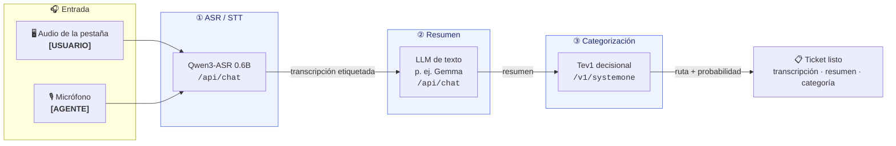

### ① Transcripción (ASR / STT)

El documento *offscreen* recibe dos `MediaStream` (pestaña y micrófono), los pasa por un **AudioWorklet** propio y los trocea en ventanas deslizantes. Cada ventana con voz se convierte a **WAV PCM16 mono a 16 kHz**, se codifica en base64 y se envía a **Qwen3-ASR** a través de Ollama.

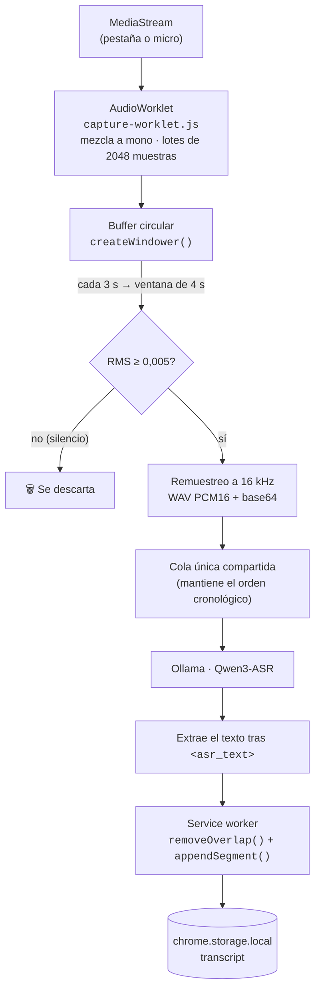

**Ventanas con solape.** Para no cortar palabras entre fragmentos, cada ventana dura 4 s pero se emite una nueva cada 3 s, así que dos ventanas consecutivas comparten 1 s de audio:

```mermaid
gantt
    title Ventanas deslizantes (WINDOW = 4 s, STRIDE = 3 s)
    dateFormat ss
    axisFormat %S s
    section Audio
    Ventana 1           :w1, 00, 4s
    Ventana 2           :w2, 03, 4s
    Ventana 3           :w3, 06, 4s
    Ventana 4           :w4, 09, 4s
    section Solape
    1 s compartido      :crit, 03, 1s
    1 s compartido      :crit, 06, 1s
    1 s compartido      :crit, 09, 1s
```

El texto repetido que produce el solape se elimina en el service worker: `removeOverlap()` compara (normalizando mayúsculas y puntuación) las últimas 2–10 palabras del segmento anterior **de ese mismo hablante** con el principio del nuevo y descarta la coincidencia más larga. Después, `appendSegment()` continúa la línea si habla la misma persona o abre una nueva con su etiqueta:

```text
[USUARIO] Hola, buenos días. Llamo porque la impresora de la segunda planta no imprime nada.
[AGENTE] De acuerdo. ¿Le aparece algún mensaje de error en la pantalla?
[USUARIO] Sí, pone "atasco de papel", pero ya he abierto la bandeja y no hay nada.
```

<details>
<summary><b>🔬 Formato del audio enviado al modelo</b></summary>

<br/>

Cada fragmento se serializa en memoria (nunca toca el disco) como un WAV estándar de 44 bytes de cabecera seguido de las muestras PCM de 16 bits:

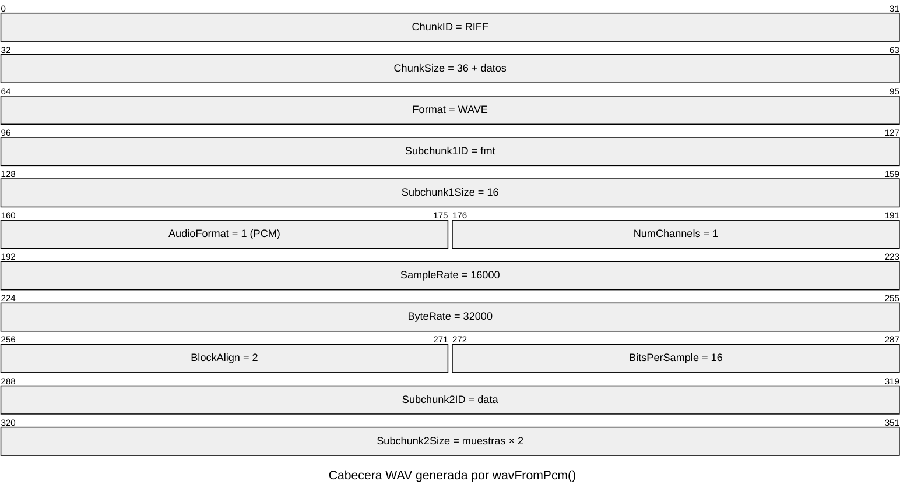

</details>

### ② Resumen

Con la transcripción etiquetada, un LLM de texto (por defecto `gemma4:12b`) recibe un *system prompt* de asistente de call center. Gracias a las etiquetas `[AGENTE]` / `[USUARIO]`, el modelo atribuye cada dato a quien lo dijo y devuelve un resumen en viñetas con:

> motivo de contacto · producto o servicio afectado · problema y síntomas · cuándo ocurre · mensajes de error · pasos que el usuario ya había probado · comprobaciones indicadas por el agente y su resultado · solución o próximos pasos · impacto o urgencia · estado final

El prompt le exige **no inventar datos** y marcar lo que falte como *pendiente de confirmar*. Es editable desde la configuración y el resultado se puede retocar a mano antes de copiarlo.

### ③ Categorización por probabilidad conjunta

La categoría la elige **Tev1**, un modelo *decisional* que, en lugar de generar texto, responde preguntas de tipo `choice` devolviendo **una distribución de probabilidad** sobre las opciones. La extensión aprovecha esto para hacer algo mejor que una clasificación voraz:

1. **Genera una pregunta por cada nodo con dos o más hijos**, redactada como probabilidad condicionada (*«Suponiendo que la incidencia pertenece a `informatica › hardware`, ¿qué subcategoría la describe mejor?»*). Las descripciones de cada categoría son los criterios.
2. **Resuelve todas las preguntas de una vez**, repartidas en las peticiones necesarias y en paralelo.
3. **Normaliza** las probabilidades de los hijos de cada nodo para obtener `P(hijo | padre)`.
4. **Recorre el árbol completo** multiplicando probabilidades y elige la hoja con mayor valor:

$$
P(\text{categoría}) = P(\text{área}) \times P(\text{subgrupo} \mid \text{área}) \times \dots \times P(\text{hoja} \mid \text{padre})
$$

¿Por qué no bajar simplemente por la rama más probable? Porque **un área algo menos probable puede contener una categoría mucho más clara**:

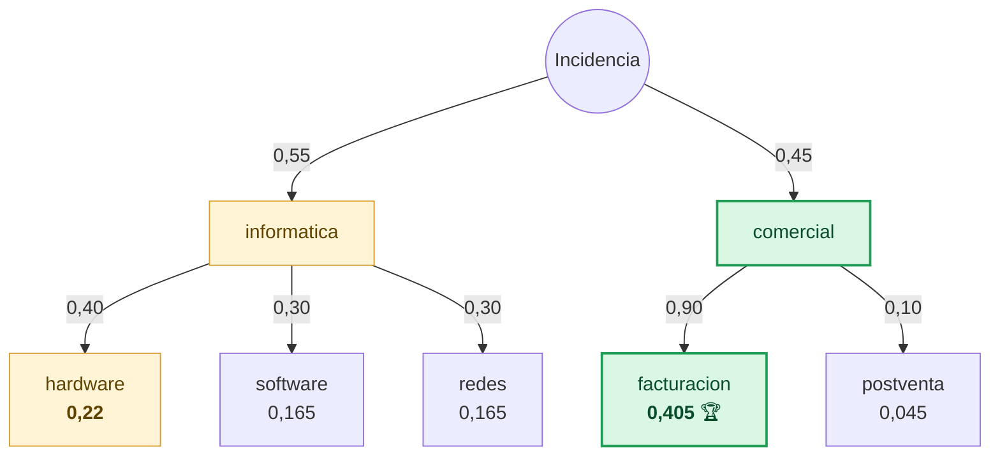

> Un algoritmo voraz habría elegido `informatica › hardware` (0,22). La búsqueda exhaustiva encuentra `comercial › facturacion` (0,405), casi el doble de probable.

**Escala con el árbol**: los nodos con más de 24 opciones se dividen en bloques con una opción extra *«ninguna de las anteriores»*, que se descarta y se renormaliza al unir los bloques; y las preguntas se agrupan respetando los límites de la API (64 preguntas y 64 KiB por petición). Los nodos con un único hijo no se consultan.

El resultado se muestra en un **selector jerárquico** con la rama ganadora desplegada y el porcentaje conjunto de cada opción evaluada. Si el agente no está de acuerdo, puede elegir otra categoría a mano.

<details>
<summary><b>🌳 Árbol de categorías por defecto</b></summary>

<br/>

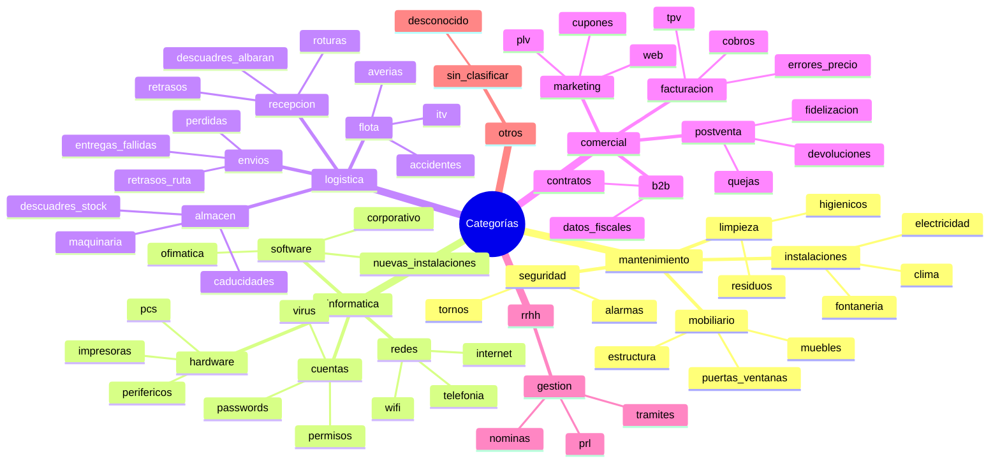

Cada nodo incluye una descripción que el modelo decisional usa como criterio. El árbol se define en [`src/config/categories.ts`](src/config/categories.ts) y se puede editar desde la extensión.

</details>

---

## 🏗️ Arquitectura

Una extensión Manifest V3 no puede capturar audio desde el popup (se cierra al perder el foco) ni desde el service worker (no tiene acceso al DOM ni a Web Audio). Por eso la extensión se reparte en cuatro contextos que se comunican con **mensajes tipados**:

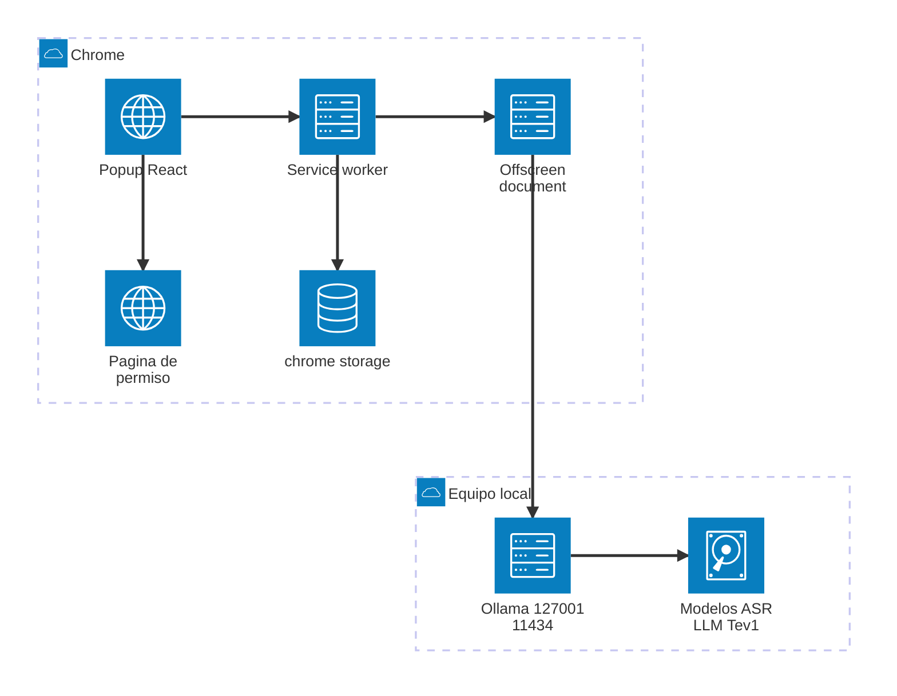

<details open>
<summary><b>Vista detallada de componentes</b></summary>

<br/>

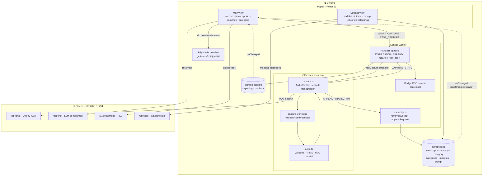

</details>

| Contexto | Responsabilidad | Ficheros |
| --- | --- | --- |
| **Popup** | Interfaz en React: botones de captura, transcripción en vivo, resumen, categoría y configuración. Lanza el resumen y la categorización directamente contra Ollama. | [`src/popup/`](src/popup) |
| **Service worker** | Orquestador: crea el documento offscreen, obtiene el `streamId` de `tabCapture`, une los segmentos de la transcripción, mantiene el estado y el distintivo **REC**. | [`src/background/`](src/background) |
| **Offscreen document** | Documento oculto con acceso a Web Audio: captura pestaña y micrófono, trocea el audio, filtra silencios y llama al modelo STT. Sobrevive al cierre del popup. | [`src/offscreen/`](src/offscreen), [`public/capture-worklet.js`](public/capture-worklet.js) |
| **Página de permiso** | Chrome no permite pedir el micrófono desde un popup; esta pestaña lo solicita una sola vez y se cierra sola. | [`src/permission/`](src/permission) |
| **Shared** | Cliente de Ollama, mensajes tipados, `chrome.storage` tipado, ajustes y operaciones sobre el árbol de categorías. | [`src/shared/`](src/shared) |
| **Categorize** | Algoritmo de probabilidad conjunta con Tev1. | [`src/categorize/`](src/categorize) |
| **Config** | Única fuente de valores por defecto editables por el desarrollador. | [`src/config/`](src/config) |

### Decisiones de diseño destacables

- **Mensajería con tipos de extremo a extremo**: `BackgroundRequest`, `OffscreenRequest` y `BackgroundResponse<T>` son uniones discriminadas; el mapa de *handlers* del service worker está tipado para que el compilador exija un manejador por cada mensaje y su respuesta correcta.
- **Generaciones de captura**: cada inicio incrementa un contador `captureGeneration`. Las respuestas del ASR que llegan tarde de una sesión anterior se descartan, y la petición en curso se aborta con `AbortController` al detener.
- **Operaciones serializadas**: `enqueueCaptureOperation()` encadena los *start/stop* para que nunca se solapen, aunque el usuario pulse rápido.
- **Una sola cola de transcripción** para ambas fuentes, de modo que el texto llega en orden cronológico aunque las dos voces se solapen.
- **Sin realimentación**: el micrófono se procesa a través de un `GainNode` a volumen 0; la pestaña, en cambio, se reenvía al `destination` para que se siga oyendo.
- **Estado reactivo**: el popup no guarda estado propio de la sesión; se suscribe a `chrome.storage` con el hook `useChromeStorage`, así que al reabrirlo muestra exactamente lo que hay.
- **Precalentamiento**: al iniciar la captura (o con **Cargar modelo**) se hace una petición vacía con `keep_alive: 30m` para que el modelo esté cargado cuando llegue la primera ventana.

---

## 🔄 Secuencia completa

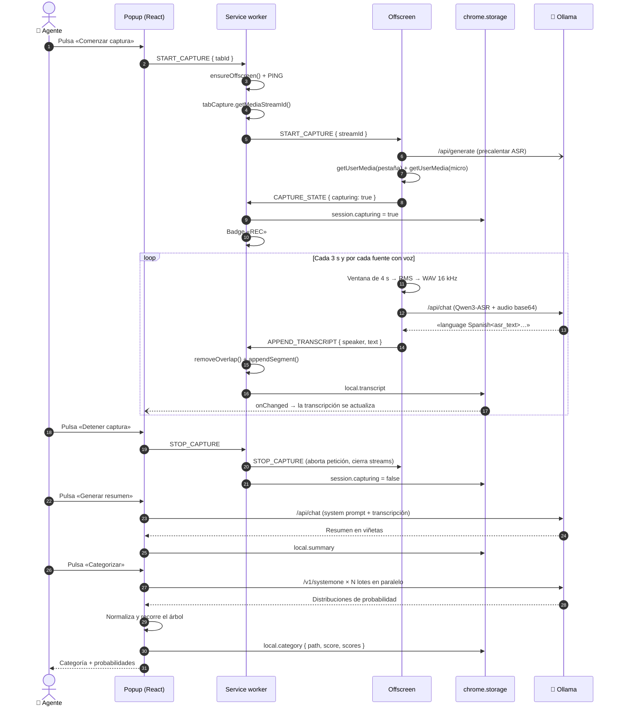

### Ciclo de vida de la captura

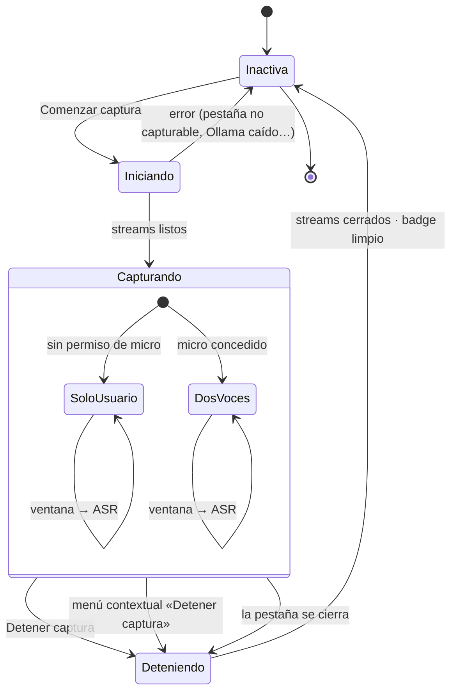

---

## 🛠️ Tecnologías

| Área | Tecnología | Uso |
| --- | --- | --- |
| Plataforma | **Chrome Extensions MV3** | `tabCapture`, `offscreen`, `storage`, `contextMenus`, `activeTab`, `clipboardWrite` |
| Lenguaje | **TypeScript 5.9** (modo estricto) | Todo el código, incluida la mensajería entre contextos |
| UI | **React 19** + CSS propio | Popup con vistas principal y de configuración |
| Iconos | **Material Symbols** | Interfaz y generación del icono de la extensión con **sharp** |
| Build | **Vite 6** + **@crxjs/vite-plugin** | Manifest en TypeScript, HMR del popup y empaquetado en `dist/` |
| Audio | **Web Audio API** · **AudioWorklet** | Captura, mezcla a mono, ventanas y remuestreo a 16 kHz |
| IA local | **Ollama** | Servidor de inferencia en `127.0.0.1:11434` |
| STT | **Qwen3-ASR 0.6B** (`frozenlab/qwen3-asr:0.6b`) | Reconocimiento de voz por fragmentos |
| Resumen | **LLM de texto** (por defecto `gemma4:12b`) | Cualquier modelo de chat instalado en Ollama |
| Clasificación | **Tev1** (`/v1/systemone`) | Preguntas `choice` con distribución de probabilidad |
| Tests | **Vitest** | 42 tests de la lógica sin interfaz |

---

## 📦 Instalación

### Requisitos

- **Google Chrome 116** o posterior
- **Node.js 20** o posterior
- **[Ollama](https://ollama.com) 0.35** o posterior (necesario para Tev1)

### 1. Descarga los modelos

```powershell
ollama pull frozenlab/qwen3-asr:0.6b   # transcripción (STT)
ollama pull gemma4:12b                 # resumen (o cualquier otro LLM de chat)
ollama pull tev1                       # categorización (modelo decisional)
```

> [!TIP]
> No es obligatorio usar estos modelos: el panel lee los que tienes instalados en Ollama y, si el modelo por defecto de un rol no está, preselecciona automáticamente el que mejor encaja.

### 2. Compila la extensión

```powershell
git clone <url-del-repositorio>
cd stt-extension
npm install
npm run build
```

### 3. Cárgala en Chrome

1. Abre `chrome://extensions` y activa el **Modo de desarrollador**.
2. Pulsa **Cargar descomprimida** y selecciona la carpeta **`dist/`**.
3. Fija el icono de la extensión en la barra para tenerla a mano.

> [!NOTE]
> Tras cambiar el código, ejecuta de nuevo `npm run build` y pulsa **Recargar** en la tarjeta de la extensión.

---

## 🚀 Uso

1. **Abre la llamada** (o un vídeo) en una pestaña web normal y pulsa el icono de la extensión. Abrir el popup **no** inicia la captura.
2. **Comprueba las fuentes**: a la izquierda de la cabecera, un punto verde o rojo indica si se puede capturar la **pantalla** (`[USUARIO]`) y el **micrófono** (`[AGENTE]`). Si el micrófono está en rojo, púlsalo para conceder el permiso: **basta con hacerlo una vez**.
3. Opcionalmente pulsa **Cargar modelo** para precalentar el ASR y pulsa **Comenzar captura**.
4. Atiende la llamada con normalidad. Puedes cambiar de pestaña: la captura sigue y el icono muestra **REC**.
5. Pulsa **Detener captura** (también disponible en el menú contextual del icono).
6. Pulsa **Generar resumen** y, cuando esté listo, **Categorizar**.
7. Revisa, ajusta si hace falta y usa los botones **Copiar** para llevar la transcripción, el resumen o la ruta de la categoría a tu herramienta de tickets.
8. **Limpiar sesión** (papelera) borra la transcripción, el resumen y la categoría para la siguiente llamada.

> [!IMPORTANT]
> Usa **auriculares**: si el micrófono recoge el altavoz, la voz del usuario aparecerá también como `[AGENTE]`.

---

## ⚙️ Configuración

El engranaje de la cabecera abre la configuración dentro del propio popup:

| Sección | Opciones |
| --- | --- |
| **Transcripción** | Modelo STT e idioma (español o inglés) |
| **Resumen** | Modelo LLM y prompt del resumen (con botón para restaurar el valor por defecto) |
| **Categoría** | Modelo decisional y editor del árbol de categorías |

### Editor de categorías

| Acción | Cómo |
| --- | --- |
| Desplegar / plegar | **▶ / ▼** |
| Mover | **Arrastrar y soltar** sobre otra fila: parte superior = **antes**, centro = **dentro**, parte inferior = **después** |
| Reordenar entre hermanas | **↑ / ↓** |
| Añadir subcategoría | **＋** |
| Eliminar (con sus hijas) | **🗑** |
| Renombrar y describir | **Clic en el nombre** |
| Nueva área | **Añadir área** |
| Volver al original | **Restaurar por defecto** |

Una categoría sin hijas es una categoría final. **Guardar** valida que no haya nombres vacíos ni repetidos entre hermanas; si vuelves atrás sin guardar, los cambios se descartan.

> [!TIP]
> La descripción de cada categoría es lo que el modelo decisional lee para elegir: cuanto más clara y distintiva, mejor categoriza.

### Valores por defecto para desarrolladores

Todo lo ajustable está centralizado en [`src/config/`](src/config). Lo que el usuario guarda en la configuración tiene prioridad sobre estos valores.

| Fichero | Contenido |
| --- | --- |
| [`app.ts`](src/config/app.ts) | Nombre, descripción e icono (`APP_ICON`, un nombre de Material Symbols) |
| [`models.ts`](src/config/models.ts) | URL de Ollama, `keep_alive`, modelos por defecto y patrones de autodetección |
| [`languages.ts`](src/config/languages.ts) | Idiomas disponibles e idioma por defecto |
| [`prompts.ts`](src/config/prompts.ts) | Prompt del STT, del resumen y preguntas de categorización |
| [`categories.ts`](src/config/categories.ts) | Árbol de categorías por defecto |
| [`capture.ts`](src/config/capture.ts) | Etiquetas de hablante, ventana/solape, umbral de silencio y procesado del micrófono |

> [!NOTE]
> Si cambias `APP_ICON`, ejecuta `npm run icons`. Si cambias la URL de Ollama, `host_permissions` del manifest se actualiza solo.

---

## 🧑‍💻 Desarrollo

| Comando | Qué hace |
| --- | --- |
| `npm run build` | Comprueba tipos y genera `dist/` |
| `npm run dev` | Servidor de desarrollo con recarga del popup (carga `dist/` una vez) |
| `npm test` | Ejecuta los tests unitarios con Vitest |
| `npm run typecheck` | Solo comprobación de tipos |
| `npm run icons` | Regenera los iconos de `public/icons/` a partir de `APP_ICON` |

### Estructura del proyecto

```text
stt-extension/
├── manifest.config.ts        # Manifest MV3 en TypeScript (@crxjs)
├── vite.config.ts
├── public/
│   ├── capture-worklet.js    # AudioWorkletProcessor de captura
│   └── icons/                # Iconos generados
├── scripts/
│   └── generate-icons.mjs    # Material Symbols → PNG con sharp
├── src/
│   ├── config/               # ⚙️ Valores por defecto editables
│   ├── background/           # Service worker: orquestación y transcripción
│   ├── offscreen/            # Captura de audio y llamadas al STT
│   ├── popup/                # Interfaz React (views, components, hooks)
│   ├── permission/           # Página de permiso de micrófono
│   ├── categorize/           # Categorización por probabilidad conjunta
│   └── shared/               # Ollama, mensajes, storage, ajustes y categorías
└── tests/                    # Tests de la lógica sin interfaz
```

### Tests

La lógica pura está separada de las APIs del navegador para poder probarla sin Chrome:

| Suite | Qué cubre |
| --- | --- |
| `audio.test.ts` | Ventanas deslizantes, RMS, WAV y base64 |
| `transcript.test.ts` | Eliminación del solape y etiquetado por hablante |
| `categorize.test.ts` | Preguntas, lotes, bloques de más de 24 opciones y probabilidad conjunta |
| `categories.test.ts` | Conversión y validación del árbol de categorías |
| `categoryOps.test.ts` | Operaciones del editor: mover, reordenar, añadir y eliminar |
| `settings.test.ts` | Ajustes, URLs capturables y elección automática de modelos |

---

## 🔒 Privacidad

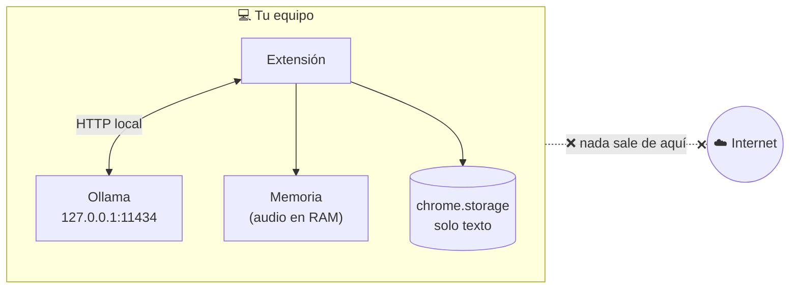

- El audio se procesa **en memoria** en ventanas de 4 s y **nunca se escribe en disco**.
- Lo único que se guarda es texto (transcripción, resumen, categoría y ajustes) en `chrome.storage` de tu navegador.
- El único host al que la extensión tiene permiso para conectarse es tu Ollama local (`host_permissions`).

---

<div align="center">

Hecho con ☕ y 🎧 por **Jon Aldekoa**

</div>
